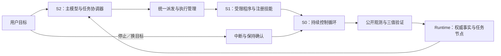

# Agentic Robotics — embuddies + CaP

一个可观察、可中断、能根据失败反馈调整动作的机器人智能体原型。主模型根据公开图像、事实和任务节点选择注册技能，或生成受限 Python；CaP Runtime 在同一环境内持续执行和验证，模型思考期间仿真不暂停。统一架构仍在改造验收中。

保留 CaP-X 的 cube_lifting、cube_stack、cube_restack，并新增基于 MuJoCo / robosuite 的通用桌面实验模式：持有、支撑物摆放、区域摆放、拆堆、反转堆叠和多对象组合。真机接口暂空；尚未证明跨硬件泛化、长期自治或持续自我改进。



## 代码目录

| 目录 | 内容 |
| --- | --- |
| desktop/ | Electron 宿主、隔离桥接与 Runtime 生命周期 |
| frontend/ | 机器人任务页、模型配置、图像、事件与停止控制 |
| runtime/robot/ | 任务协调、模型请求、恢复状态、预算、案例检索与测试 |
| cap-runtime/agentic_cap/ | HTTP／SSE、持续仿真、解释器、CaP 技能、验证和监控 |
| cap-runtime/tests/ | 协议、几何、取消、预算与故障边界测试 |
| cap-runtime/experiments/ | 仿真诊断、固定程序与离线评测代码 |
| research/ | 历史实验脚本、版本清单和结果摘要 |
| docs/ | 架构、实现边界和研究记录 |

## Windows 工作台

安装 Node.js 24；在仓库根目录执行：

```powershell
npm ci --prefix frontend
npm ci --prefix desktop
npm ci --prefix runtime
npm run build --prefix frontend
.\start-embuddies.ps1
```

在设置中配置支持图片的模型渠道，以及固定的 CaP Runtime 地址和访问令牌。模型密钥保留在桌面端加密配置，不发送给 CaP Runtime。新任务默认保存到 `%LOCALAPPDATA%\embuddies\data\robot-tasks`；`start-development.ps1` 使用独立开发数据目录。

应用重启会查询原任务并请求保持，不自动重放动作。旧 embuddies 用户数据不会自动迁入机器人状态。

## Linux 板子本机使用

Thor 板子源码位于 `/home/li/projects/agentic-robotics`。本机浏览器入口为
`http://127.0.0.1:8787`，应用菜单入口为 **Agentic Robotics**。
依赖、服务、密钥迁移与测试边界见[Linux 板子使用说明](docs/linux-board.md)。

## Linux 仿真服务

真实后端依赖外部 CaP-X、仿真器和模型权重。先完成[依赖说明](docs/dependencies.md)中的环境准备；本仓库不包含模型权重或上游依赖安装目录。

在仓库根目录、已安装上游依赖的 Python 环境中，分别启动三个服务：

```bash
export CAP_PROJECT_ROOT="$PWD"
export JAX_PLATFORMS=cpu XLA_PYTHON_CLIENT_PREALLOCATE=false
export CUBLAS_WORKSPACE_CONFIG=:4096:8
# 在独立终端／进程运行；GPU 编号按设备配置调整。
CUDA_VISIBLE_DEVICES=0 python cap-runtime/scripts/capx_services.py sam3
CUDA_VISIBLE_DEVICES=1 python cap-runtime/scripts/capx_services.py grasp --deterministic-seed 0
python cap-runtime/scripts/capx_services.py pyroki
```

它们默认监听本地 8114／8115／8116。再启动 Runtime：

```bash
cd cap-runtime
export CAP_RUNTIME_TOKEN='replace-with-a-random-token-at-least-16-characters'
export MUJOCO_GL=egl JAX_PLATFORMS=cpu
python -m agentic_cap.server --backend cap --upstream /absolute/path/to/cap-x \
  --host 127.0.0.1 --port 8120 --records /absolute/path/to/robot-records
```

部署者负责提供工作台可达的固定服务地址；远程连接通过部署者配置的 TLS 入口。产品不包含 SSH 连接、自动部署或连接发现。

实验中的候选能力需要显式打开，默认关闭：

```bash
export CAP_ACTIVE_EVIDENCE=1
export CAP_PLACEMENT_EVIDENCE=1
export CAP_HOLDING_WATCHDOG=1
export CAP_SUPPORT_SECOND_VIEW=robot0_eye_in_hand
```

需要独立仿真评分时，在 Runtime 命令增加 `--evaluation`。它只保存离线私有记录，不向模型提供仿真真值。缺少该参数的运行只能报告公开验收结果。

## 测试与构建

```powershell
npm test --prefix runtime
npm test --prefix frontend
npm run build --prefix frontend
python -m pip install -r cap-runtime/requirements-test.txt
python -m unittest discover -s cap-runtime/tests -p "test_*.py"
node runtime/scripts/stage-robot-runtime.mjs build/runtime
.\build-windows.ps1 -SkipArchive
```

协议与几何测试不需要模型密钥、GPU 或 CaP-X；真实仿真诊断另需上述依赖。`--backend fixture` 只用于协议验证，不能用于机器人成功率。研究辅助脚本不进入产品工具清单。

## 当前结果与边界

最近冻结的真实模型自然任务回归：抬起、堆叠、重堆叠各一次，seed 90，公开与独立物理检查均完成，零错误完成声明。重堆叠用满 12 次决策，堆叠约 276 秒；不能据此宣称稳定成功率或泛化收益。此前失败与缺少独立记录的运行单独保留。

本轮修复释放后运动容差与最终取证净空条件的衔接：取证技能可在有效释放路径中补做一次有限竖直撤离，再用新观测检查原净空阈值。四次固定程序仿真诊断中，可恢复遮挡由 unknown 变为 verified，持续遮挡仍为 unknown；未验证本轮真实模型自然任务收益。见[修复、对照结果与边界](research/agentic_clearance_composition_20261120/v1/结果与边界.md)。

上述为历史阶段结果；最新 Python 检查为 388 项通过，最新发布检查见下方通用桌面实验报告。测试结果不计机器人成功率。详见[此前冻结实验结果](docs/results-20261120.md)、[架构与能力边界](docs/agentic-roadmap-alignment.md)及[研究记录范围](research/README.md)。

主模型支持 observe、run_code、ask_user、finish；Runtime 提供统一状态契约时还支持 run_skill。注册技能与 CaP 短程序共用执行器、取消和预算。当前架构改造及未完成范围见[统一机器人系统契约](docs/robot-system-contract.md)。生成代码无法使用通用文件、网络、终端或环境对象；执行完成与物理效果分开。证据不足保持 unknown，完成请求仍需 Runtime 验证。现有保护针对限定仿真任务，不构成真机碰撞或急停保证。


## 通用桌面实验模式（默认关闭）

架构、接口和运行命令见 [通用模式说明](docs/generic-robotics.md)。S2 动态提出计划，S1 通过公开 RGB-D、抓取候选及隔离的 ASPIRE/cuRobo 提供器执行，S0 唯一推进仿真；独立监控与三值验证贯穿任务。

[54 次冻结对照](research/generic_robotics_followup_20261124/FORMAL_RESULTS.md)已完成。直接 CaP、完整系统无经验、完整系统有经验三组公开确认均为 16/18，错误完成均为 0；物理完成分别为 17/18、18/18、17/18。本轮没有证明经验收益，经验仍默认关闭。

[多视角开发对照](research/geometry_evidence_20261125/RESULTS.md)新增 6 次运行，物理与公开验收均通过。但两个单视角对照也通过，不能据此宣称多视角提升成功率或已经修复历史误拒。候选需显式使用 `--perception multiview`；原阈值不变，未切换生产服务默认版本。

原始 RGB-D、模型交互、本地配置和冻结源码备份留在 Thor；GitHub 包含实现、测试、协议及精选结果。新检出环境需要另行准备上游依赖、权重、模型配置和服务，代码推送不会自动部署。
