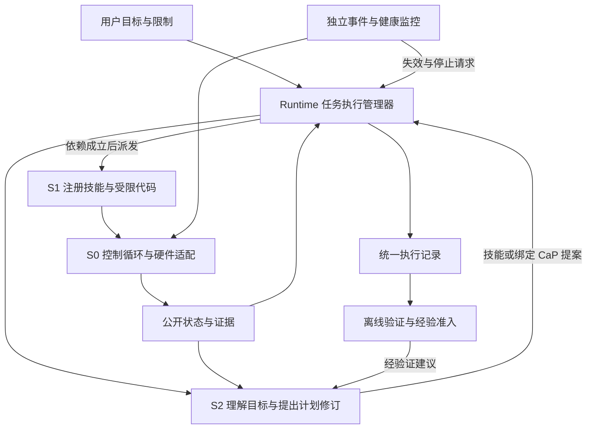

# 总体架构：已有骨架与下一轮缺口

更新：2026-11-21（Linux 板子）。本文是当前源码审计与后续设计，不代表所列能力已经实现。目标仍是让状态、任务、技能和执行器形成一致系统。

## 核心判断

目前是限定方块场景的带验证机器人智能体：S2 选择技能或短代码，S1 执行受限组合，S0 持续控制，Runtime 提供事实和验收。问题不在层数，而在各层之间的权威与失败转换尚未完全封闭。

现有 `robot_system.py` 已加入 `TaskExecutive`，技能与绑定代码共用节点准入、尝试分类、当前推进方向和历史记录；公开 HTTP 已强制节点绑定。它还不是完整的任务执行管理器：任务配方、恢复链选择与升级求助仍需完善。主模型承担的程序细节已经减少，但仍需选择有限的恢复出口。不能将有这些模块等同于长期自治已经成立。

## 缺口与顺序

| 顺序 | 架构缺口 | 应怎样修改 | 验收依据 |
| --- | --- | --- | --- |
| P0 | 统一契约的全部入口与故障门槛需验收 | 公开 HTTP 已强制节点绑定，进程内工程调用单列；继续审计各种故障下的目标版本、依赖、预算与节点效果 | 直接 HTTP 拒绝无节点动作及幂等已有测试；真实模型物理闭环仍需验收 |
| P0 | 任务执行管理尚未覆盖完整恢复链 | 已加入共用生命周期策略，区分当前事实、节点进展和执行尝试；继续统一恢复、任务改写与求助的转换 | 历史成功不替代当前事实、新证据不抹除旧失败、换目标隔离已有测试；完整物理恢复链仍需证据 |
| P1 | 任务结构与对象绑定写死在方块模板 | 现有模板已迁入声明式任务配方；下一步允许 S2 提议受限节点变更；Runtime 验证变更，不接收任意任务图 | 新增一个受支持工作流不需修改核心执行逻辑；未知能力被明确拒绝或求助 |
| P1 | 技能的失败出口与任务恢复尚未系统化 | 技能契约统一记录前置条件、效果、执行中失效条件、取消结果和允许的恢复；区分程序错误、证据不足、动作失败与设备异常 | 各类故障触发不同且可审计的转换；缺证据先取证，不盲目重复抓放；剩余预算约束整个恢复链 |
| P1 | 监控覆盖与失效隔离不足 | 在已有持有监控上逐项增加观测失效、控制进度和后端健康监控；明确监控请求停止与 S0 确认保持的责任。碰撞／外力需有传感来源后实现 | 模型等待、代码执行和网络断线时均可停止；控制线程自身卡死不能依赖该线程自救，需独立看门狗或设备保护并实测 |
| P2 | 经验尚未形成经验证的能力增长 | 关闭任务后提取参数化修复候选，独立验证后入库，按当前事实检索；新技能仍走相同契约、审批与版本机制 | 冻结任务对照证明减少重复失败或成本，负例不误用；命中经验本身不算收益 |

公开事实目前覆盖红绿方块的持有、支撑与放置关系，含来源和新鲜度。后续任务扩展需增加稳定对象身份、坐标系、谓词与多来源证据规则；当前没有必要先训练通用世界模型。真机接口按用户要求留空，跨硬件是后续适配和验收目标，不能从 Python 接口相同直接推出。

## 目标结构

图中的任务执行管理器是下一轮需完善的职责，不表示新增独立 Agent 或单独服务。S2 提出策略，Runtime 决定提案是否可执行，S1 负责阶段内反馈，S0 承担实际控制。界面只展示上述权威记录。

## 第一轮改造边界

先做 P0，保留三个现有任务、相同环境实例和几何阈值。将正常执行、证据失效、动作失败、取消、换目标、超时和求助统一到同一套转换表；先用协议故障测试，再以真实模型与物理仿真逐项验收。之后再扩大任务模板与技能范围，避免用新增场景掩盖执行管理不一致。

板子上的真实模型闭环已覆盖开发种子 12 的三个任务：抬起与普通堆叠通过公开及独立物理验收；重堆叠仍因释放前支撑证据丢失而未完成，但模型已实测选择授权撤回。旧固定诊断在撤回后主动结束，不能据此判定系统不会继续恢复。

本轮发现循环：高位支撑证据可用 → 下降后未知、释放被拒 → 撤回 → 相同放置重新就绪。已增加 Runtime 任务内失败路线约束；安全撤回不清除失败证据，相同公开放置上下文不再重复派发。腕部相机单次对照未补足证据，保持关闭。下一步优先解决动作全过程的可观测性，而非提高重试预算。[本轮证据和限制](../research/native_recovery_20261121/结果与边界.md)。

详情见[统一改造计划](unified-system-plan.md)、[系统契约](robot-system-contract.md)与[物理诊断结果](../research/agentic_unified_system_20261120/结果与边界.md)。
