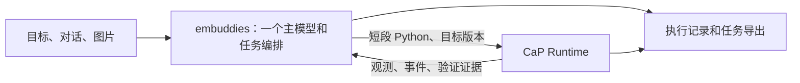

# Agentic Robotics MVP：实现与验收

最新工程状态（2026-11-19）：Python 122 项、Node 42 项通过。主模型在限定故障交接中已自主完成撤回后修订放置；持续遮挡时取证两次后请求人工处理，未释放或误报完成。Runtime 在真实 CaP 中通过无客户端／HTTP 挂起／运动到期三项保持并自动关闭诊断。见[模型恢复记录](../research/agentic_vertical_retreat_model_20261119/v1/结果与边界.md)、[截止结果](../research/agentic_deadline_20261119/v1/结果与边界.md)及[综述职责对齐表](agentic-roadmap-alignment.md)。安装包仍是旧冻结版本，未替换已安装应用；下文历史计数保留原版本范围，不能合并为当前系统成功率。

## 实现

| 模块 | 文件 | 职责 |
|---|---|---|
| 任务页 | frontend/src/RobotWorkbench.tsx | 目标、图像、停止、执行与证据 |
| S2 | runtime/robot/coordinator.mjs | 单模型闭环、目标版本、恢复和记录 |
| 模型传输 | runtime/robot/model.mjs | 复用模型渠道、图片输入及 JSON 决策 |
| Runtime | cap-runtime/agentic_cap/core.py | 任务、预算、事件、唯一物理控制线程 |
| 解释器 | cap-runtime/agentic_cap/interpreter.py | 受限 Python AST；不用 exec/eval |
| CaP 适配 | cap-runtime/agentic_cap/cap_backend.py | 现有视觉、抓取与 IK 的可取消适配 |
| 独立评测 | cap-runtime/agentic_cap/evaluator.py | 仿真真值只写评测文件，不进入模型上下文 |

创建、步进、渲染、释放 MuJoCo 均在唯一控制线程。运动 API 只提交关节目标并等待。夹爪原有步进调用改为等待 tick。感知使用复制的公开 RGB-D／编码器快照；压缩、FK、证据处理与落盘在独立线程。

停止先使旧模型结果失效，再让 Runtime 切换为当前关节保持及原夹爪命令，收到 hold_confirmed 才报告停止。耗时感知／IK 可放弃等待，其接口绑定原代码段，迟到结果不能向下一段提交动作。

目标变化或静止期间物体可见性／位置实质变化更新版本；位置阈值 2 cm，tick 不递增版本。决策绑定模型实际看到的版本，派发前再检查。每个表达式和接口检查取消与累计预算。

执行 running/completed/cancelled/failed 与效果 verified/failed/unknown 分开。段 effect 和 goal_verification 针对最终目标；可选 contract.postcondition 另产生 stage_verification，因此抬起阶段可以成功而最终堆叠仍未达到。contract.preconditions 只接受已有公开目标关系，failed 或 unknown 均阻止整段派发。finish 只触发最终验证。

调用 started/result/error 通过 call_id 对齐；结构化 feedback 保留阶段、接口、观测引用、原始效果和运动误差。类别描述观测到的失败，不把未知物理原因写成既定事实。验证器异常返回 unknown 并释放代码段。界面分别显示代码执行、阶段效果与最终目标，代码 completed 显示“已执行”。

默认累计 12 次模型决策、40 次公开工具调用、1500 个运动控制步、300 秒墙钟。目标解释也计数，等待步单列。禁用原 Robosuite 按所有 tick 计数的 horizon，由 Runtime 统一管理预算。

墙钟到期由 Runtime 独立取消当前段、确认保持，再自动关闭并记录 `termination_reason=wall_budget_exhausted`，不依赖工作台重连。物理环境清理时间另计；此机制依赖健康控制循环，不替代硬件看门狗。工作台重连读到该终止原因后作废迟到模型输出，终止任务不接受新目标改写。

## HTTP 协议

固定服务地址，所有请求使用 Authorization Bearer 令牌，不通过 URL 传密钥。

| 方法与路径 | 职责 |
|---|---|
| POST /episodes | create_episode，request_id 幂等 |
| GET /episodes/{id} | get_episode，权威状态 |
| GET /episodes/{id}/observe | 带时间和证据引用的公开状态 |
| POST /episodes/{id}/segments | execute_segment，立即返回 ID |
| POST /episodes/{id}/cancel | cancel_segment，确认保持状态 |
| POST /episodes/{id}/goal | 先停再换目标 |
| POST /episodes/{id}/decisions | 累计模型决策预算 |
| POST /episodes/{id}/verify | 验证 finish |
| GET /episodes/{id}/events?after=N | SSE，支持 Last-Event-ID 补齐 |
| POST /episodes/{id}/close | 释放环境 |
| GET /episodes/{id}/export | 记录包 |

同一请求 ID、同一内容返回原 ID，内容冲突拒绝。重启只标记 interrupted，不重建旧场景、不重放代码。记录目录跨服务重启保持相同。

工作台导出 JSON 含完整输入输出及 workbench_jsonl、runtime_zip_base64。解码后者得到 ZIP：事件和状态直接可读，图像与深度在 observations.tar.xz 中，再解压一次即可按原路径读取。PNG 像素和 NPZ 内 NPY 数组保持不变，仅重编码压缩；全部等待帧保留。模型请求正文与响应保留；Authorization 和密钥不写入记录。

## 验证边界

### 主动取证（第一阶段）

放置任务现在提供受限的 `inspect_support(support_name, held_object_name)` 技能。它只读取公开 RGB-D 和机器人状态；当支撑物缺失或可见范围明显截断时，最多沿两个有界横向视角移动，并在每次移动后重新检查持有状态和支撑物证据。证据仍为 `unknown` 时，Runtime 拒绝释放夹爪，不能用代码完成或模型声明代替验收。每次技能调用、视角尝试、前后证据和预算消耗都写入事件记录。

主动取证初轮专项为 11 项 Episode 集成测试，覆盖取证中停止／换目标、未知证据下禁止运动与释放、持有丢失、两次未知、重复请求、累计预算和事件导出。该轮完整开发版为 84 项 Python、38 项 Node 测试通过（含独立截止保护测试）；当前计数见页首。统计属于工程回归，不是机器人成功率。

新固定程序回归（61／62、stack／restack，共 8 次）已完成：passive 独立物理完成 1/4，主动组 2/4，3 次 unknown→available，错误完成声明 0。重堆叠的取证已成功，但下降后再次遮挡，Runtime 拒绝释放，仍未完成。另一次真实模型的 8 次配对实验已在全部任务关闭后独立评分：baseline 物理完成及自主确认 1/4，candidate 4/4，误报均为 0；两次自主取证均恢复证据。小样本不支持统计显著性或泛化结论，不与固定程序结果合并。技能仍需显式 `CAP_ACTIVE_EVIDENCE=1` 启用。完整状态见 `docs/agentic-roadmap-alignment.md`。

首个真实 CaP 工程烟测已完成：`cube_stack/61` 在持有红方块后调用 `inspect_support("green cube", "red cube")`，公开证据当时已可用，因此使用 0 次视角移动并写入开始／结束事件；本次任务累计 163 个运动步、185 个等待步、约 26.5 秒。`cube_restack/22` 的旧驱动未声明阶段后置条件，把阶段 unknown 当作抓取失败而提前停止；该日志不能证明物理抓取失败，也未进入主动取证。后续固定程序已使用明确的持有合同。两次旧烟测不作为模型能力或任务成功率结论。

沿用已有红／绿方块公开 RGB-D 表面估计和 holding_evidence：观察窗口至少 20 控制步，抬高至少 4 cm、TCP 距离不超过 10 cm、相对漂移不超过 2 cm。检查等待已发布窗口完整，避免相机处理延迟导致永久 unknown。最终效果窗口不使用最近动作前的观测，避免旧成功证据被误用于新动作。

放置使用可见几何对齐带及释放后持续观察，只适用于这些限定场景，不能代替接触真值。遮挡、缺深度、窗口不足返回 unknown。table 关系尚无经过校准的公开支撑面验证，返回 unknown。

单侧可见时，表面包围盒中心可能偏离方块中心。仅在先前公开 RGB-D 提供完整尺寸、当前侧面平面残差不超过 2 mm、法向接近水平轴且侧面跨度充分时，利用该尺寸与可见平面估计中心；其他情况保留保守判断。未放宽堆叠的水平／高度／时间阈值。这项几何先验仅适用于当前方块场景。

夹持检查另返回公开可见包围盒中心相对 TCP 的估计偏移及当时 TCP 姿态。放置时保持姿态并补偿偏移，避免把斜向抓取后的 TCP 误当作物体中心。偏移是观测估计，仍须由释放后的检查验收。

## 工程验证

- Python 23 项、Node 10 项、前端 2 项测试通过；TypeScript 和 Vite 构建通过。
- Electron + HTTP 测试模型 + fixture：三场景完整闭环及导出通过，9 次模型请求；旧通用路由全部拒绝。这不是机器人成功率。
- 真实 CaP：五秒模型延迟时，三场景推进 4.80、4.90、4.75 秒，约 0.96、0.98、0.95 倍实时。停止及同场景抓空后继续均通过，未 reset。
- 正常固定程序实验：部分代码段执行完，但独立评测未证明三个任务完成，失败保留。
- 真实模型使用已有 gc 渠道的 gpt-5.6-sol，直接输入当前图像及公开状态；SAM3、GraspNet、Pyroki 只服务于注册的感知／动作接口。模型密钥留在 Windows 工作台。
- 抬起：6 次决策、7 次接口调用、349 运动步，公开验证与独立评测均通过，Runtime 墙钟约 82 秒。
- 堆叠：11 次决策、22 次接口调用、441 运动步，公开验证与独立评测均通过，Runtime 墙钟约 176 秒；同一场景处理了两次运动失败。
- 重堆叠：12 次决策、31 次接口调用、624 运动步，Runtime 墙钟约 174 秒、含目标理解总耗时约 181 秒。公开验证与独立评测均通过；同场景处理了采样失败、遮挡和第一次放置偏边，reset_count=1。
- 重堆叠研发过程中保留了：一次物理成功但公开 unknown、三次抓取／放置失败耗尽预算，以及场景创建前的模型连接和目标结构错误。最终成功不抹去这些失败。
- 原始约 145 MB 的任务包，经无损跨帧压缩与时间排序后约 6.6 MB，生成约 11 秒。成功重堆叠的完整任务包已从发行 EXE 经实际远程连接导出：Runtime ZIP 5,759,201 字节，含工作台输入输出的 JSON 约 9.4 MB，总耗时 33.6 秒。
- 发行 EXE 不带启动参数时，原 gc 模型密钥及 Runtime 令牌均能从既有加密存储读取，未新建不兼容的加密身份。
- 导出包回读通过：12 次模型请求的输入像素保持一致，694 个 RGB-D 帧及证据引用完整；最终公开验证在最新动作时间约束下回放仍为 verified，独立评测为 true。

三个任务均已有真模型闭环成功样例，正常执行、同场景恢复、持续仿真、停止、版本失效、unknown、幂等、重连／重启、接口边界和记录导出均有测试覆盖。其中目标变化、重启和代码边界主要由协议／协调器测试验证；尚未完成固定版本多种子成功率统计，也未做真机或跨硬件验收。不能把这次工程回归解释为 100% 成功率。

## 精简与旧数据

274 个旧源码文件已移出项目，保存在本机 C:\Users\LPN19\Desktop\毕业设计\research\agentic_mvp_backup_20261118\retired，附路径、长度和 SHA256 清单。原有未提交修改也保留于备份。旧用户数据库、密钥、对话、资源与硬件数据未删除。

发行按实际导入图收集 14 个运行模块，拒绝 SSH、通用硬件、浏览器、原生回退等模块混入。旧 Rust 工作流已替换。未做经验学习、微调、跨硬件实验或 RSI。

## 后续诊断试验（2026-11-18，独立于首轮验收）

详见 [改进依据与实验协议](agentic-improvement.md)。冻结的阶段证据候选版在 seeds=11、12 的三任务共 6 次试验中，独立成功 5 次；保留旧决策／控制行为、仅补服务身份信息的基线在相同任务／种子上独立成功 6 次。两组均无误报完成，初始物体位置逐对一致。每个任务／种子仅一次模型采样，未交错运行，不能证明候选版提升或统计退化，也不能据此声称 100% 成功率。

候选版 seed=12 重堆叠出现放置偏移、修正抓取失败，12 次决策耗尽后未完成。结构化证据有助于记录问题，但本轮没有证明它提高抓放可靠性。后续须先做重复试验、动作与几何诊断，再决定默认策略；当前候选 EXE 作为实验构建保存，不替换已安装应用。

当前 Python 36 项、Node 14 项、前端 3 项测试通过，类型检查和构建通过；新候选发行 EXE 的三场景 fixture／旧路由拒绝／导出验收通过。fixture 不计机器人表现。两个版本的 12 个完整 Runtime 记录包均已下载并通过 ZIP CRC 检查，独立真值只在执行后读取。

## 2026-11-19：真实模型对照与完成确认

后续 8 次真实模型配对对照见 [证据候选与完成确认](llm-evidence-experiment.md)。两组物理结束窗口均完成 4/4，自主确认均 3/4；未证明任务证据摘要和新增观察提示词有整体收益，因此该候选未进入默认策略。

默认版本保留完成确认修正：正常结束的代码段若已获 Runtime 最终目标 verified，则在当前版本重新公开验收，通过即完成，不再消耗额外模型决策。独立真实 CaP 工程回归验证第 12 次决策完成目标时可正常结束；它使用脚本决策，不计模型成功率。动作后等待验证窗口的问题仍未完全解决。

最终默认 Node 18 项通过，TypeScript/Vite 构建通过，14 个运行模块；便携 EXE 三场景 fixture、旧路由拒绝和导出通过，共 6 次测试模型调用。未替换已安装应用，也没有新增真机、经验学习或跨硬件结论。
