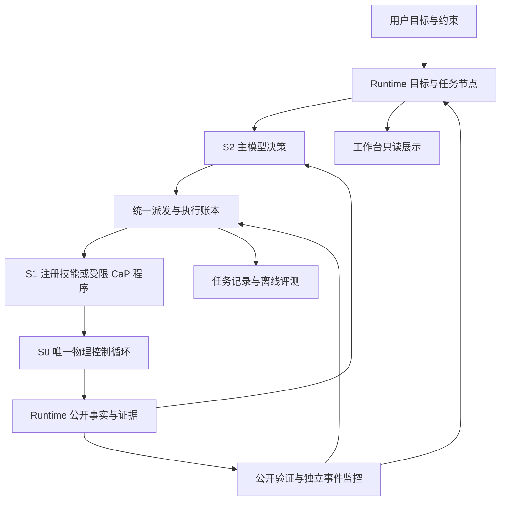

# 统一机器人系统契约

本轮架构改造仍在进行中。目标是让状态、任务、技能、执行器共用可检查的契约；不是增加独立 Agent。物理能力证据与协议测试分开记录。

## 职责与权威



- `robot_system.py`：Runtime 将公开传感器、既有验证结果、当前目标与执行账本投影成事实和任务节点；内部 `TaskExecutive` 共用技能／代码准入与尝试分类，发布当前任务推进方向。它不读仿真真值，不相信模型的完成叙述。
- `skills.py`：注册参数、所需事实、可测效果和受限程序。任务节点与派发共用技能要求，编译器不能由模型覆盖。
- `task_recipes.py`：Runtime 内注册任务配方，绑定对象角色、节点依赖、所需事实、效果及释放后的验收路线。核心执行器不再分支构造方块任务图。配方仍限现有谓词与技能，不接受模型上传可执行配方。
- `core.py`：技能和 CaP 入口共用解释器、API 账本、取消、目标版本、物理保持确认及预算。最终目标验证与状态投影读取同一份公开结果。
- `coordinator.mjs`：将权威契约给主模型，处理用户输入和模型回复。`remaining_steps` 是模型建议，不是任务节点的完成状态。
- 工作台：显示 Runtime 节点和当前证据；过期结果不能继续显示为当前目标成立。完成时的验收记录保留为历史事实。

这些模块仍部署在原有工作台与 Runtime 两个进程体系中。控制循环持续推进，感知／模型请求在控制循环之外等待。真机具体适配保持留空。

## 对外状态

`observe.system` 与 `get_episode.system` 使用 `contract_version: 1`：

| 字段 | 含义 |
| --- | --- |
| `episode_id / revision / goal_version` | 环境、实质场景版本和目标版本；换回原目标仍产生新目标版本 |
| `state_id` | 一份公开状态的引用；用于决策依赖检查，不是重放物理状态的令牌 |
| `world.source` | 帧引用、采集时间、控制步及版本 |
| `world.facts` | 持有、可见、尺寸、支撑、持有偏移、支撑面边界、空夹爪、放置关系等三值事实 |
| `task.nodes` | 当前节点、参数绑定、事实要求、依赖、Runtime 后置条件、适用技能、最近执行尝试 |
| `task.execution / task.nodes[].lifecycle` | 当前推进阶段、下一步方向、可执行节点，以及当前目标版本内的尝试次数和历史结果 |
| `task.recipe / task.assistance` | 当前配方与参数角色、动作覆盖范围，以及 Runtime 权威求助状态 |
| `skills` | 注册技能、参数、事实要求模板和可测效果模板 |
| `executor` | 当前段、执行方式和监控警报 |

事实为 `verified / failed / unknown`。缺少或过期的观测不能用作动作依据；`failed` 的含义只限对应公开谓词，没有推出未知的物理原因。保持未确认时不能发布可执行动作依据。

服务端使用原有一秒证据窗口。界面在服务端年龄上增加整个请求 RTT 和本地单调时间，避免跨机器时钟偏差。缓存查询不触发传感器或仿真重放；过期缓存统一降为 unknown。

状态帧更新本身不会增加目标／场景版本。派发可以引用同版本较早的状态，但必须使用最新公开事实重新检查依赖。换目标、监控中断或实质场景变化仍会使旧请求失效。

动作执行期间，普通场景变化延迟提交，避免自身运动使当前段取消；停止、换目标和持有监控仍独立生效。段结束时，Runtime 在同一锁内将最新已发布传感包与实质场景基线比较、更新 revision，再发布空闲状态和 `segment_finished`。段记录增加 `result_revision` 与 `result_evidence_ref`，关联结束时的版本及观测；它们不表示效果成功。后续新传感包仍按原 2 cm 位移／可见状态变化规则更新版本，小幅漂移仍对最近实质基线累计比较。这只消除已经观测到的动作结果延迟发布，不保证模型思考期间场景永远不变。

## 技能派发

新增 `POST /episodes/{id}/skills`：

```json
{
  "request_id": "unique-request",
  "revision": 1,
  "state_id": "copy-the-64-character-runtime-state-id",
  "task_node": "1:place",
  "skill": {
    "name": "place_object",
    "arguments": {"object": "red cube", "support": "green cube"}
  }
}
```

立即返回 `segment_id`。同请求、同载荷返回原段；同请求异载荷拒绝，不重新执行。无效版本、未知依赖、错误节点或参数在动作前拒绝。注册技能只适用于当前限定任务中的合法对象和支撑物。

| 技能 | 派发要求 | 公开效果 |
| --- | --- | --- |
| `acquire_object` | 空夹爪、目标可见；堆叠任务还需确认目标上无反向堆叠 | 持有目标物 |
| `place_object` | 持有、有效持有偏移与姿态、支撑证据、支撑面边界、物体尺寸 | 目标物在支撑物上且空夹爪 |
| `inspect_support` | 持有目标物 | 新支撑证据与继续持有 |
| `inspect_placement` | 空夹爪、当前目标对应的释放记录 | 放置关系且空夹爪 |
| `retreat_from_descent` | 新鲜、有效且对应当前物体的下降反向路径授权；闭合夹爪上下文 | 保持夹爪命令，撤回后重新确认持有 |

实际传感器路径的抓取复用既有方块定位与竖直顶抓程序，随后抬升并验证；放置使用测得偏移，释放后沿实际末端位置竖直撤离。采样抓取曾在第一轮架构诊断中三次失败，因此当前技能限定为方块顶抓，不把任意采样姿态当成可执行保证。动作仍受现有运动、放置、取证守卫约束，不增加碰撞安全保证。fixture 的 `pick/place_on` 只服务协议测试。

执行线程在首个公开 API 前再次检查节点依赖。注册技能及绑定 CaP 段保存 `task_binding`，关联请求状态、派发状态、目标版本、所需事实和 Runtime 后置条件。`execution` 是程序是否结束，`stage_verification` 是段契约，`node_verification` 是 Runtime 节点效果，`skill_verification` 是注册技能公开效果，`goal_verification / effect` 是最终任务目标；它们不能互相替代。

模型 CaP 请求携带 `task_ref: {state_id, task_node}`；协调器和公开 HTTP `/segments` 均拒绝缺失引用的代码。节点效果由 Runtime 定义，模型不能用较弱的段契约把移障失败变成节点成功。代码修复保留原节点并重新绑定当前状态；换目标后的旧修复不继续执行。仅 Python 进程内 `Episode.execute` 保留无引用工程调用，不提供对应 HTTP 旁路。

`TaskExecutive` 从同一执行账本提取生命周期，不另存一份完成状态。每个绑定段在全部验收后生成 `task_outcome` 和 `task_attempt_finished`，区分程序拒绝、证据不足、效果失败、执行失败、取消、预算耗尽、接口异常和保持未确认。节点 `lifecycle` 保存历史尝试；`status` 与 `current_satisfied` 只反映当前公开事实。新证据可恢复就绪，但不会改写旧失败。目标切换后旧版本尝试不参与当前推进。

普通停止和异常保持共用 `hold_ack < hold_serial` 准入栅栏。保持未确认时，全部公开事实与条件验收为 unknown，新模型决策和代码／技能均不能派发。`executor.hold_pending` 表示是否还有待确认的保持请求；真正的停止确认仍由控制循环的确认事件提供。

`POST /episodes/{id}/assistance` 接收请求 ID、当前 revision、origin 和 reason。Runtime 先关闭派发栅栏，再请求控制循环保持，确认后发布 `awaiting_user`。同请求不重复保持，异载荷拒绝。当前代码的迟到 API 不能执行；求助不复位环境或清零预算。解释用户新指令的模型决策仍计入原预算，只允许 `purpose: interpretation` 在等待期间预留；它本身不解除动作栅栏。用户新目标通过原目标接口后，创建新 goal_version 并清除求助状态。旧求助的迟到保持请求有 revision 检查，不能停止新目标动作。

配方的依赖边用于解释流程；可执行性由当前事实要求决定。已经成立的状态无需为了历史顺序重做动作。纯验收节点不能作为 CaP 动作入口；没有动作配方的已接受谓词会标记 `verification_only`，模型应澄清或求助，不自动转成其他任务。完整任意任务规划、停放技能和模型生成任务图的准入仍未实现。

释放后最终关系 unknown 时，抓取／放置节点进入 `awaiting_verification`，先取证，避免根据缺失证据立即重复抓取。证据恢复是否说明完成仍由最终公开验证决定。

下降后支撑证据丢失、释放被拒绝时，`recover` 节点只在既有 Runtime 反向路径守卫给出授权后可执行。当前低位持有可以是 unknown；系统不将历史持有当作当前证明，也不凭空生成新路径。技能仅执行记录的竖直反向目标并检查持有，不开放夹爪。路径失效后旧模型选择会在派发前拒绝；实际运动仍再次经过原有路径守卫。此恢复入口已在板子上的真实模型＋MuJoCo 重堆叠诊断中完成撤回并验证持有；这是恢复阶段证据，最终重堆叠仍未完成。

## 放置失败的跨恢复约束（2026-11-21）

`placement_retry.py` 从公开支撑表面估计位置、已验证抓持尝试/方向及相机覆盖提取 `retry_context`，由 Runtime 准入时复制到 `task_binding`。只有当前目标版本内、`open_gripper` 因支撑证据 unknown 被拒的尝试参与约束；程序错误、取消和释放后最终验收 unknown 不误归为同一故障。

失败后，即使撤回恢复了当前持有和高位可见性，只要放置上下文没有实质改变，`place` 节点仍为 blocked，并发布 `retry_constraint` 及原释放证据引用；相同节点的技能与绑定 CaP 均不能派发。授权撤回优先保留，完成撤回且没有其他就绪路线时，任务发布 `placement_route_blocked / change_placement_evidence_or_ask_user`。求助仍须经过物理保持确认。

比较使用 1 cm 支撑估计中心变化与 5° 抓持方向变化作为重复路线启发式，不改变任何抓取、支撑或完成验证阈值。帧号、时间、revision、被持物世界位置、同一抓持内的偏移估计漂移和成功撤回均不单独构成路线修复。恢复可见范围引起的单侧边界变化也不直接视为支撑物移动。公开几何、抓持方式或相机覆盖变化仅允许重新检查原有前置条件，不代表成功。旧目标失败不影响新版本；旧记录若没有上下文则不虚构约束。语义契约更新为 `bounded-cube-recovery-v8`，经验导入器与服务端摘要一致。

## 尚未完成的范围

- 当前任务投影限方块任务，未实现通用任务图生成或复杂依赖重规划。
- 重堆叠获取遮挡物使用注册抓取技能，移障使用绑定 CaP；两种入口已有同环境协议测试。移障还没有注册的停放技能，板子真实模型诊断已完成移障节点，但未证明跨场景可靠性。
- 当前已统一节点准入、配方、失败分类、尝试历史和求助栅栏，任务执行管理仍不完整；受限任务改写与恢复链选择仍需进一步统一和实测。当前模块不会自动重试或自行生成新恢复授权。
- 未证明新注册抓取／放置技能在自然模型任务上优于原短代码流程；真实仿真诊断与模型评测必须分别报告。
- 监控已有公开夹持矛盾，碰撞、外力与更广泛环境变化没有独立覆盖。
- 经验模块的验证准入／检索仍是窄案例，不是通用技能学习；适配新契约后还需重新验收。
- 真机与跨硬件能力未实现。

完整要求与阶段见 [统一改造计划](unified-system-plan.md)。只有所有约定范围均有对应证据后，才能宣布架构目标完成。

## Support geometry source consistency (2026-11-22)

selected_support_geometry is shared by task support_geometry facts, place_object compilation and placement retry context. A secondary view contributes geometry only when the public selector returned available; freshness, synchronization and calibration remain checked by that selector. Missing primary geometry no longer discards a valid selected secondary view. Selected camera and evidence reference remain in the fact result.

Board regression: Python 255 and Node 97 tests passed. Fixed-controller cube_restack on development seeds 12/22 with primary-only and wrist-secondary remained unknown/physically incomplete in all four cases. The real-model seed22/wrist run completed an authorized retreat and requested assistance without completing the goal. These results do not establish camera-policy improvement. See ../research/support_geometry_20261122/results.md.

## Experimental alternate held-object orientation (2026-11-22)

CAP_ALTERNATE_PLACEMENT=1 opts into a skill-only reorient task node after an actual rejected release and authorized retreat. It requires current verified holding/geometry and a bounded two-cube high-clearance envelope. The skill keeps TCP position and grip, tries at most two yaw alternatives, and checks holding again. It cannot be used as a bound-CaP entry point. Failed/cancelled trials consume the same goal-local allowance; stop, goal changes, idempotency and original cumulative budgets remain enforced.

This is not general collision certification or dynamic task-graph synthesis. A completed yaw does not certify a release or goal; every placement still requires current support evidence and its release guard. Production defaults off. Initial fixed-controller development evidence and all failures are retained in [reorientation report](../research/reorientation_20261122/results.md).

## Registered skill budget headroom (2026-11-22)

The acquire compiler omits open_gripper only when the existing fresh public empty-gripper verifier confirms the open command and measured aperture. Missing, stale, closed or insufficient aperture keeps the explicit open operation. Localization, approach, closure, measured lift and holding checks still run through the same interpreter and cancellation fences.

Before the registered place skill opens the held target, its release wrapper requires at least two API calls left after charging the open attempt: current measured TCP retrieval and vertical retreat. Insufficient headroom records placement_release_budget_blocked and halts before opening. This does not reserve motion/wall time or suppress cancellation, and is not a guarantee of all future operations. It only applies to the registered place sequence; arbitrary CaP programs are not assumed to have that structure.

Development regression: Python 269 and Node 104 checks pass; fixed-controller seed22 alternate recovery completed its entire registered sequence with exactly 40 calls. Real-model lifting and stacking with the experimental capability enabled passed physical evaluation. Further results and limits: [recovery cost](../research/recovery_cost_20261122/results.md).


## 决策前的传感就绪与求助复核（2026-11-22）

公开观测的 `decision_evidence` 只描述传感新鲜度、动作后时间关系和 holding/on 关系所需的时间窗覆盖。`ready` 不代表持有、支撑或最终目标成立；`pending`、`unknown` 也不授权动作。当前限定方块任务统一覆盖这两种关系，复用既有 verifier 的时间窗要求，不更改几何阈值。

工作台在模型预算预留前，最多花 3 秒等待 pending 窗口；仿真继续运行，等待计入任务墙钟成本，观测轮询不增加机器人 API 账本。就绪、未知或旧后端无此协议时立即停止自动等待。超时保留最后真实观测与原始 pending 状态，另记 timed_out，不伪造 ready；首次观测完全失联则有界失败并进入原有保护保持流程。停止、目标切换和墙钟截止可中断传感请求，迟到结果不得写入下一目标。

时间窗完整但事实未知时，主模型读取具体样本：混合过渡窗口可说明下一窗口预期获得的证据；持续遮挡需要可用的主动取证路线或求助。不得以等待代替视角问题的修复。

对于基于 Runtime 任务状态的 ask_user，工作台在正式求助前重新观测。只有同一环境、同一目标版本内，旧状态没有合法路线、最新鲜且空闲的 Runtime 状态新增合法路线时，记录 `assistance_reconsidered` 并重新请求模型。每次真实模型请求仍消耗累计预算，不自动派发新动作。不变的 blocked、已有路线时的主动求助、陈旧状态、保持未确认、活动段或新目标，均不得被此规则覆盖。求助时仍使用原 Runtime 动作栅栏和保持确认。

工作台记录 `decision_evidence_wait_started/finished`，模型上下文携带等待结果、最终观测引用、轮询次数与实际耗时。记录只证明取证过程，不证明效果成功。


## 阶段 API 资源契约（2026-11-22）

`program_resources.py` 对已通过受限解释器语法与绑定检查的 AST 分析公开 API 调用数，不执行程序或读取仿真真值。保留条件分支的上下界，按解释器最多 16 次循环计算动态循环上界，统计参数与赋值下标中的 API；普通 builtin 不消耗机器人调用。inspect_support 包含至多两次移动和三次持有检查，inspect_placement 包含一次净空撤回和至多两次观察移动的嵌套账本。

每个估计区分 `minimum_calls / maximum_calls / required_calls`。前两项是提交代码的路径调用数范围；required_calls 还保留最终放置任务中 open_gripper 后测量和撤离所需的两次调用余量。完整尾段已包含在程序内时不重复加价；仅提交释放一行代码也不能隐藏后续余量需求。此余量是资源预留要求，不能证明任意生成代码实际包含正确的撤离或满足任务语义，仍需 Runtime 后置验证。

`RobotSystem.resources.remaining` 提供累计剩余预算；节点 `resources.skills` 从同一技能编译器和同一成本分析产生 fits/insufficient/unknown。任务投影列出 `affordable_skill_routes / resource_blocked_skill_routes`。ready_nodes 仍表示事实与任务依赖就绪，不等同于任意代码或注册技能都可负担；生成 CaP 按实际提交程序重新分析。

执行线程先完成整段语法检查，再生成 `program_resources_checked`。若当前 API 余额小于 required_calls，则该段以 failed、resources_insufficient 结束，API 账本不增加，也不提交运动或夹爪指令。记录保持确认、目标绑定及独立效果验证，不把资源拒绝称作抓取或放置失败。相同请求仍返回原段。真实逐调用预算、取消、持有监控及墙钟/运动限制继续生效。

预算预测只覆盖当前提交程序的 API 路径及上述释放余量，不是全任务可行性、碰撞证明、耗时预测或成功保证。动态分支采用保守上界，因此可能拒绝实际较短的路径。运动步与墙钟需求明确为 unknown，不用零值假装已预测。最终释放的即时余量保护同时用于注册技能和生成 CaP。语义契约升级为 bounded-cube-recovery-v9，并把 program_resources.py 纳入工作台与 Runtime 的共同摘要。


## 有条件的后续路径资源（2026-11-22）

阶段成本不代表剩余任务可完成。`task_recipes.py` 为当前 Runtime 节点给出成功后的后继节点或最终目标验证条件；`continuation_resources.py` 只读取任务投影与同一编译器产生的资源估计，组合 `RobotSystem.resources.completion_paths`。它不创建独立规划 Agent，不执行或排队未来动作，也不读取仿真真值。

每条候选包含当前起始节点、未来阶段、当前观测状态及要求、API 下界／上界／余量、剩余调用数和附加模型请求数量。`insufficient_registered_path` 表示该注册阶段序列即使按已知调用下界也不够；不能推广为所有生成代码或物理策略均不可行。`conditional_branch_budget` 表示较短分支可能够、上界不够。`conditional` 只说明这条成功路径的 API 上界和余量能容纳，仍不证明未来观测、碰撞可行性、效果或全任务成功。任一未来生成程序没有成本、注册路线无法编译、图缺失／循环或估计不合法时保持 unknown，绝不把未知成本当零。

未来节点即使当前 blocked，也只作为 `deferred_not_authorized` 的条件后继，不能提升为 ready。当前已满足的中间取证阶段可在估计中跳过，但明确假设其事实持续成立；动作后若改变，必须重新取证，旧估计失效。每段后仍由主模型读取新观测、Runtime 检查当前依赖，没有自动展开整条路径。安全撤回不能因缺少最终完成预算而被当作可省略的动作；模型只应避免无可负担后续路径的可选恢复。

观测过期、目标／版本变化、预算账本变化、活动执行、保持未确认或等待人工协助时，缓存状态不继续提供旧候选路径。模型仍需核对累计决策、运动和墙钟预算；附加模型请求数量不把已预留的当前请求当免费预算，不参与硬判定。后续路径只是现有受限任务的注册选项，生成 CaP 的实际成本与语义仍需单独验证，不是通用任务规划器。语义契约升级为 bounded-cube-recovery-v10，摘要同时包含 continuation_resources.py。


后续路径与恢复职责分别建模：`recover` 节点标记 `purpose: restore_recorded_pose`，其联合路径标记 `completion_budget_must_not_suppress_current_action`。`task.execution.priority_restore_routes` 仅列出当前事实允许且单阶段预算可容纳的记录下降撤回；主模型应先恢复该姿态，再决定是否有预算继续目标，不能因为整个目标已不可负担就跳过已授权撤回。这个标记不自动派发、不声称任意姿态绝对安全，也不覆盖用户停止或目标变更。

`inspect_support` 的任务准入增加显式条件 `retreat_path:{object} == unknown`，与其原有低位撤回检查一致。当 recorded_vertical_reversal 可用时，任务图不再把侧向取证标为可直接执行，即使 holding 当前为 verified；生成代码仍受原始低位路径保护。此处 unknown 是该特定事实中“没有已验证撤回授权”的既有表示，并不是把一般未知事实视为安全证据。
