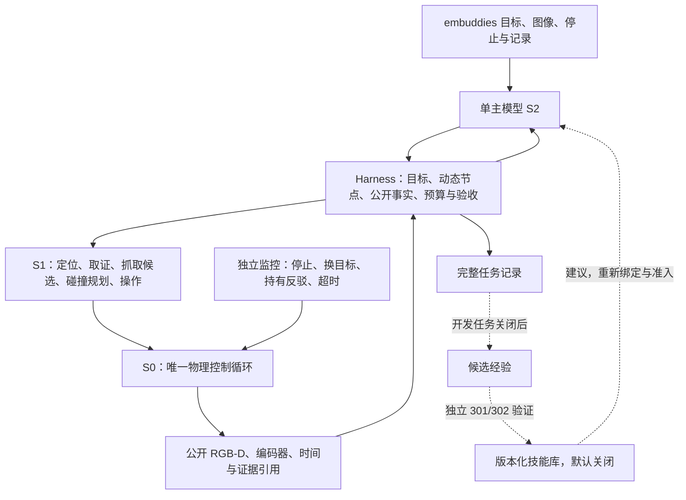

# 通用 Agentic Robotics：实现与阶段验收（2026-11-24）

本轮只修改 Thor `/home/li/projects/agentic-robotics`，Windows 未改动。状态：架构和实验工具已实现，物理阶段 C 未通过，不能宣称完整方案已验收。

## 现在实际运行的闭环

主模型不接触环境句柄、文件、网络或仿真真值。场景配置与目标解耦；对象使用目录 ID；目标为 holding、on、in_region、empty_gripper 合取。Runtime 保存计划并在每次派发时重查前提，模型不能改前提或验收规则。短代码局部变量每段清空，环境与累计预算保持。公开取消先提升派发版本，再等待控制线程保持确认，防止迟到 HTTP 请求复活动作。

通用模式预算为 24 次决策、80 次公开调用、3000 个运动步、600 秒墙钟。支持桌面布局和初始堆叠布局，包含方块、长方体、圆柱、平面支撑和两个标定区域。新增模式独立 opt-in，不替换原三个方块入口。

## 代码在哪里

| 职责 | 实现 |
|---|---|
| 目标、注册能力、强制前后置条件 | `cap-runtime/agentic_cap/tabletop_domain.py` |
| 动态计划、事实依赖、历史尝试 | `tabletop_system.py`、`tabletop_episode.py` |
| 连续仿真、相机与提供器桥接 | `tabletop_backend.py`、`tabletop_simulation.py` |
| 受限能力、抓取/放置/主动取证/记录路径恢复 | `tabletop_actions.py` |
| 公开三值验收 | `tabletop_sensors.py` |
| 离线候选、验证和发布 | `tabletop_memory.py`、`experiments/tabletop_skill_validation.py` |
| 独立物理评分、冻结对照 | `tabletop_evaluation.py`、`tabletop_campaign.py`、`experiments/tabletop_campaign.py` |
| 模型闭环 | `runtime/robot/tabletop-model.mjs`、`coordinator.mjs` |
| 工作台入口及证据展示 | `runtime/robot/application.mjs`、`frontend/src/RobotWorkbench.tsx` |
| 实际模型开发试验 | `runtime/scripts/tabletop-model-trial.mjs` |

协议、命令和依赖见 `docs/generic-robotics.md`、`docs/generic-robotics-dependencies.json`。上表省略目录的 Python 文件均在 `cap-runtime/agentic_cap/`。

## 复用与限制

- ASPIRE 固定 `fa00f0ef2bc1d91d594b9aa502c22133c9f538f7`，实际使用类型、客户端与 cuRobo 提供器。cuRobo 固定 `a35a708ecfbb26eb9ab2d7ef22c65919c4fae4a9`，上游仓库保持干净并保留许可证。
- Thor aarch64 的 cuRobo GPU 导入和实际轨迹规划已通过，探针返回 27 步 collision-aware 轨迹。环境隔离在 `.venv-curobo`，原 Torch/CUDA/MuJoCo 版本未替换。日志为 `curobo-planning-probe.log`。
- MAESTRO 的扫描—候选—规划组织方式、EMOS 的设备描述、TAMPAgent 的证据准入、ENPIRE 的候选验证流程用于设计参考；没有声称运行它们的完整框架或复现它们的实验结果。
- 当前适配只有仿真 Panda，传感器为固定 RGB-D 和腕部 RGB-D。跨硬件接口是架构边界，尚无第二设备结果。
- 当前碰撞规划使用公开观测点云与机器人模型，**没有携带物体碰撞模型**；未知遮挡不等于自由空间。Pyroki 未被当作碰撞规划器。
- 感知为 SAM3 身份、当前 RGB-D 跟踪和有限形状测量。几何约束仅适用于声明的桌面刚体；不是任意对象/语言关系的通用验证器。

## 已执行检查

最终自动检查为 Python **372**、Node **126**、界面 **10** 项通过，类型检查与构建通过；源码摘要由 `checks-final.json` 和 `source-provenance-final.json` 记录。fixture 只证明协议，不计为机器人成功。

真实 S2 注入 5.013 秒模型等待时，仿真推进 **4.900 秒（约 0.978 倍）**、98 控制步；运动中停止确认 **0.0537 秒**，确认后新增运动步为 0；运动中换目标仍为同一环境，旧请求被拒绝；创建/执行幂等通过。证据为 `physical-fault-probe/checks.json`。这是一轮仿真检查，不代表全部负载或真机的延迟。原 lifting、stack 回归公开通过；restack 当前与修改前对照均为 unknown，不能列成已通过的原任务。

停止、迟到结果、换目标、幂等、累计预算、重启中断、未知证据准入、节点条件不可修改和评测隔离均有自动测试。新模式真实模型试验使用现有模型配置，未微调，未向模型提供六类目标对应的任务程序。

## 开发实验，不是冻结成功率

多轮修改之间的结果不合并。开发种子只使用 201/202；以下成功只代表各自记录对应的代码版本。

| 记录 | 结果 | 解释 |
|---|---|---|
| `acceptance-development/independent-results.json` | hold、support、region、reverse 的公开与物理均成功 | 同一批版本；不能代替新验证器下的完整六类回归 |
| `post-fence-development/independent-results.json` | unstack 双通过；multiple 公开成功、物理失败 | 后者属于错误完成，阻止发布 |
| `boundary-fixed-development/independent-results-v3.json` | region 双通过；multiple 未完成，公开未成功，物理未成功 | 新证据边界拒绝不足证据；24 次决策耗尽，无错误完成 |

错误完成原始 episode 为 `4fcbe4ee631f573c1c4facdb71e9fd3f`。蓝色方块外沿超出区域约 1.54 毫米；旧公开验证只检查表面 2%/98% 分位范围，遗漏了完整占据范围。原事件、图像、物理记录和错误完成标记全部保留，不能从结果中删除。

修复增加观测极值、受限测量补全与 10 毫米开发期测量余量。可见表面明确越界为 failed；外沿余量不足为 unknown；不会通过放宽区域定义让失败变成功。此参数尚未冻结，只在新通用模式使用，原方块任务阈值不变。独立评分 v3 同时改为使用旋转后的实际几何，取消区域任务未要求的直立姿态限制；原 v2 评分仍保留。本次修复覆盖已发现的反例，不代表已证明其他遮挡与几何估计不会误报。

修复后 multiple/202 消耗 24 决策、59 调用、812 运动步、约 244.6 秒后停止。主要瓶颈是低位放置的持有证据不稳定，模型多次恢复后重复同一操作。安全停下属于边界有效，不属于任务成功。

## 阶段门槛

| 阶段 | 状态 | 尚缺证据 |
|---|---|---|
| A：接口与执行语义 | 部分通过 | 旧 restack 物理回归仍 unknown，虽然修改前对照同样失败 |
| B：通用状态与动态计划 | 协议/fixture 通过 | 不将协议通过等同于新任务物理通过 |
| C：六类新目标物理闭环 | **阻塞** | 新验证器下六类双通过未齐，multiple 的持有/放置恢复不可靠 |
| D：经验闭环 | 机制实现，未通过独立实验 | 现有候选仅 proposed；301/302 验证、发布及收益对照未完成 |
| E：工作台 | 源码和构建通过，默认入口未切换 | 未把未验收通用能力发布为默认功能 |

`gates.json` 为机器可读门槛。冻结评测入口会拒绝不完整门槛、缺少证据、被改写的任务/条件、模型/Runtime/技能版本变化。正式 701/702/703 未运行，54 次对照未启动，没有统计显著性或经验收益结论。

## 部署状态与下一项

新 Python Runtime 和 S2 源码使用隔离 8121 端口试验；生产 Runtime 8120 和工作台 8787 未重启，通用模式未设为默认。前端构建产物已更新，但必须同时启用 `EMBUDDIES_GENERIC_TABLETOP=1` 且 Runtime 返回 schema=2 才显示新入口；旧运行服务不会展示不可用入口。源码摘要与运行版本必须分开阅读。

下一项不是增加对象配方，而是解决**低位接触、遮挡及视角变化下的持有证据**，并使重复恢复产生新证据或改变有效条件。通过当前严格边界后，再重跑六类目标；只有 C 通过才执行独立候选验证和正式三组对照。当前不发布、不把 proposed 候选作为经验建议，也不把旧版本零散成功合并为“通用能力已完成”。

## 最终文件与部署核对

- `checks-final.json`：最终检查及物理故障探针。
- `gates.json`：阶段门槛；正式评测仍被阻断。
- `source-provenance-final.json`：磁盘源码、包版本和运行契约摘要。
- `deployment-status.json`：生产服务与磁盘 Runtime 摘要不同，状态为 restart_required。
- `campaign-draft-current.json`：54 次设计草案，明确未准入、未启动。
- 工作台新增运行版本与部署状态展示，预算显示读取 Runtime 的 24/80/3000 限额。
- 在线导出保留公开事件与图像，不含 evaluation-private 文件；独立评分原始文件仍保存在 Thor。
